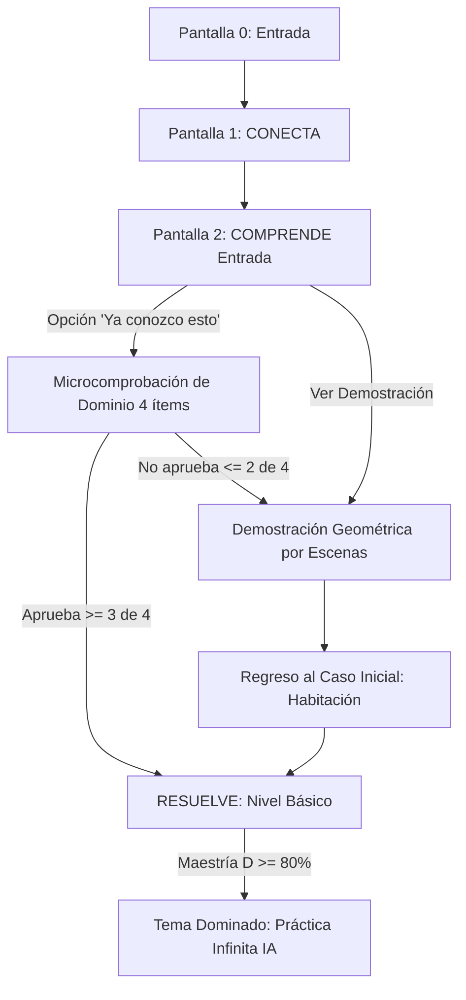

# ESPECIFICACIÓN FUNCIONAL Y PEDAGÓGICA
## Plataforma adaptativa para el aprendizaje de Matemática
### TEMA PILOTO: TEOREMA DE PITÁGORAS
**Documento de implementación para el equipo de desarrollo · Versión 2.4**  
**Responsables pedagógicos:** Diego Rodríguez y Gabriela Jácome

---

## 1. Propósito y alcance

Definir con precisión qué debe construir el equipo de desarrollo, qué debe ocurrir en cada pantalla, cómo debe responder la plataforma a las acciones del estudiante y qué decisiones corresponden exclusivamente al diseño pedagógico. El documento es autosuficiente: no debe requerir conversaciones previas para ser interpretado.

### 1.1 Tema piloto
El tema seleccionado es **Teorema de Pitágoras**, por su carácter visual, su bajo número de prerrequisitos y su capacidad para demostrar una secuencia pedagógica completa.

### 1.2 Nivel curricular de referencia
Educación General Básica Superior (9.° EGB). La arquitectura debe permitir aplicar posteriormente el mismo sistema a otros niveles y temas sin rehacerlo.

### 1.3 Modalidad
- Apoyo al aprendizaje presencial.
- Experiencia autónoma o virtual.
- Recurso de práctica y seguimiento posterior a una clase.

### 1.4 Plataformas soportadas
El sistema debe funcionar correctamente en computador, tableta y teléfono.

### 1.5 Qué debe demostrar la plataforma
1. Que existe una **secuencia pedagógica explícita y reusable**.
2. Que el contenido no aparece de forma espontánea ni desconectada.
3. Que el estudiante puede recibir apoyos distintos sin ser etiquetado mediante estilos de aprendizaje.
4. Que el sistema puede adaptar la práctica según el desempeño.
5. Que el conocimiento puede descomponerse en **microcompetencias medibles**.
6. Que el docente puede observar resultados individuales y grupales con suficiente detalle para tomar decisiones pedagógicas.

> [!IMPORTANT]
> **Alcance Técnico:** No es necesario implementar todavía el motor adaptativo definitivo. Sí es obligatorio construir el sistema de manera que dicho motor pueda sustituirse o enriquecerse posteriormente sin rehacer las pantallas ni la estructura de los temas.

---

## 2. Arquitectura pedagógica universal

Cada tema deberá conservar la misma estructura general. El contenido cambia; la arquitectura no.

| Etapa | Pregunta que responde | Función |
| :--- | :--- | :--- |
| **CONECTA** | *¿Para qué necesito esto?* | Presenta una situación que genera la necesidad matemática, sin exigir que el estudiante conozca todavía el procedimiento. |
| **COMPRENDE** | *¿Por qué funciona?* | Construye significado mediante representación, explicación y formalización progresiva; predominantemente visual. |
| **RESUELVE** | *¿Puedo hacerlo?* | Presenta práctica adaptativa hasta obtener evidencia suficiente de dominio. |

> [!WARNING]
> **Principio Obligatorio:** Ningún tema debe iniciar con una fórmula o definición formal. La formalización aparece únicamente después de que la experiencia haya construido la necesidad y el significado matemático.

### 2.1 Cuatro componentes independientes del sistema
Deben mantenerse conceptualmente separados aunque interactúen entre sí:
1. **Ruta pedagógica:** ¿Qué debe aprender el estudiante y en qué secuencia? Es la secuencia conceptual oficial del tema; no depende del docente ni del capricho del estudiante.
2. **Motor de dominio:** ¿Cuánto necesita practicar? Determina el estado de cada microcompetencia con base en evidencia acumulada, y decide cuándo mantener, aumentar o disminuir la dificultad.
3. **Motor de experiencia:** ¿Cómo conviene presentárselo? Registra qué apoyos e interacciones resultan eficaces (pistas, representaciones, repeticiones, tiempo). No asigna etiquetas rígidas de estilo de aprendizaje.
4. **Capa docente:** ¿Con qué enfoque o material adicional practicará? El docente observa, asigna, complementa y analiza; la plataforma entrega la ruta curricular base.

### 2.2 Independencia entre temas
Cada tema deberá poder estudiarse como una unidad independiente:
- Pitágoras tendrá su propio CONECTA.
- Ley de Senos y Cosenos tendrá su propio CONECTA.
- Ningún tema dependerá narrativamente de haber completado el anterior.

---

## 3. Principios de diseño no negociables

1. **Una idea principal por pantalla o estado.**
2. **Las representaciones visuales deben utilizarse cuando aporten comprensión real;** el texto explica lo necesario, no reemplaza lo que un gráfico puede comunicar mejor.
3. **Las animaciones deben explicar matemática,** nunca usarse como simple decoración.
4. **Volver, repetir, pausar o solicitar apoyo no penaliza al estudiante.**
5. **La práctica no tendrá una cantidad fija visible de ejercicios.**
6. **El sistema no clasificará al estudiante como “visual”, “auditivo”, “activo”, “reflexivo”, etc.**
7. **La interfaz debe ser seria, clara, académica y contemporánea;** puede incorporar recursos interactivos y dinamismo, pero **no debe depender de gamificación superficial infantil**.
8. **Control agéntico estricto del avance:** El usuario no navega libremente entre etapas como si fueran pestañas independientes; el tutor y el motor pedagógico sitúan al estudiante en la etapa correspondiente a su progreso real.

---

## 4. Estructura visual de las pantallas

Todas las pantallas de aprendizaje deberán conservar cuatro zonas:
1. **Encabezado:** tema, aula, progreso general.
2. **Indicador de etapa CONECTA–COMPRENDE–RESUELVE:** estado visual no navegable libremente por el alumno.
3. **Área principal de contenido:** lienzo interactivo / simulación geométrica / ejercicio.
4. **Acciones del estudiante y mediación socrática.**

---

## 5. Flujo general del tema (Máquina de Estados)

> [!CAUTION]
> **Regla Funcional:** El botón “YA CONOZCO ESTO” nunca permite saltar directamente a la práctica sin verificación. Requiere aprobar la microcomprobación breve (3 de 4 ítems). Si aprueba, entra obligatoriamente al nivel Básico de RESUELVE, nunca directamente a un nivel superior.

---

## 6. Especificación de Pantallas y Escenas (Teorema de Pitágoras)

### Pantalla 0 · Entrada
- **Objetivo:** Presentar el tema sin adelantar la fórmula.
- **Elementos:**
  - Título: *Teorema de Pitágoras*.
  - Subtítulo: *“Descubre cómo relacionar las longitudes de un triángulo rectángulo”*.
  - Ilustración limpia y geométrica.
  - Botón primario: **COMENZAR**.
- **No mostrar:** Fórmula ($a^2 + b^2 = c^2$), definición formal, video introductorio ni explicación previa.

### Pantalla 1 · CONECTA (La Habitación en Construcción)
- **Situación en pantalla:**
  Una habitación tiene dos paredes contiguas de $6\text{ m}$ y $8\text{ m}$. Al colocar las baldosas del piso, estas no quedan correctamente alineadas. Las baldosas están bien cortadas y las longitudes de las paredes son correctas. Surge una sospecha: *¿Las paredes forman realmente un ángulo de $90^\circ$? No tenemos una escuadra gigante. ¿Cómo podríamos comprobarlo utilizando solamente mediciones de longitud?*
- **Interacciones:**
  - Campo opcional: *“Tengo una idea”* (se guarda como participación, no califica).
  - Botón primario: **CONTINUAR**.
- **Regla pedagógica:** No sugerir previamente “medir la diagonal”.
- **Transición:** Tras continuar, se anima la medición de la diagonal y se revela: **$10,18\text{ m}$**. Aparece la pregunta clave: *“Si las paredes formaran exactamente $90^\circ$, ¿cuánto debería medir esa diagonal?”*. Botón: **DESCUBRIRLO** $\rightarrow$ conduce a COMPRENDE.

### Pantalla 2 · COMPRENDE (Entrada)
- **Elementos:** Triángulo rectángulo limpio, catetos $a$ y $b$, hipotenusa $c$, ángulo recto marcado.
- **Acciones:**
  - **VER DEMOSTRACIÓN:** Acción principal. Abre la deducción geométrica por escenas.
  - **LEER EXPLICACIÓN:** Explicación textual equivalente sin alterar la secuencia.
  - **YA CONOZCO ESTO:** Abre la microcomprobación diagnóstica (4 ítems: PIT-01, PIT-02, PIT-06, PIT-07).

### 6.1 Microcomprobación de “Ya conozco esto”
- 4 ítems: PIT-01 (reconocer triángulo rectángulo), PIT-02 (identificar catetos e hipotenusa), PIT-06 (calcular hipotenusa), PIT-07 (calcular cateto).
- Sin botón PISTA ni RECORDAR CONCEPTO.
- Aprobación: $\ge 3$ de 4 ítems correctos.
  - Si aprueba: avanza a **RESUELVE (Nivel Básico)**.
  - Si no aprueba: regresa a **COMPRENDE (Demostración geométrica)**.

---

## 7. Demostración geométrica: secuencia prescriptiva (Bhāskara)

> [!IMPORTANT]
> **Secuencia Obligatoria:** La deducción se realiza mediante cuatro triángulos rectángulos congruentes rotados que forman un cuadrado exterior de lado $(a + b)$ y dejan un cuadrado interior de lado $c$.

- **Escena 1 (Triángulo base):** Triángulo rectángulo con catetos $a, b$ e hipotenusa $c$. Ángulo recto marcado.
- **Escena 2 (Formación del cuadrado):** Desplazar y rotar 4 copias hasta armar el cuadrado exterior con cuadrado interior inclinado.
- **Escena 3 (Área exterior):** Lado $(a + b)$. Área total: $A = (a + b)^2$.
- **Escena 4 (Área por partes internas):** 4 triángulos de área $\frac{ab}{2} \rightarrow 2ab$, más cuadrado interior $c^2$. Área total: $A = 2ab + c^2$.
- **Escena 5 (Igualación y cancelación):**
  $$(a + b)^2 = 2ab + c^2 \implies a^2 + 2ab + b^2 = 2ab + c^2$$
  Cancelación visual simultánea de $2ab$ en ambos miembros:
  $$a^2 + b^2 = c^2$$
  **Solo en este momento** se muestra el rótulo oficial *"Teorema de Pitágoras"* y su definición.

---

## 8. Regreso al caso inicial

Tras la deducción formal, la plataforma regresa a la habitación:
$$6^2 + 8^2 = 36 + 64 = 100 \implies c = \sqrt{100} = 10\text{ m}$$
- **Diagonal esperada:** $10,00\text{ m}$ (si fuera recto a $90^\circ$).
- **Diagonal medida:** $10,18\text{ m}$ (medición real en la obra).
- **Conclusión:** Las paredes no están a escuadra; no forman $90^\circ$.
- Botón primario: **PRACTICAR** $\rightarrow$ conduce a RESUELVE.

---

## 9. RESUELVE: Práctica adaptativa

### 9.1 Niveles de dificultad
| Nivel | Obligatorio | Qué evalúa | Criterio |
| :--- | :--- | :--- | :--- |
| **Básico** | Sí | Aplicación directa | Hipotenusa o cateto desconocido con esquema explícito. |
| **Intermedio** | Sí | Interpretación contextual | Contexto aplicado donde debe decidir cómo usar Pitágoras. |
| **Avanzado** | Sí | Modelación | El esquema matemático no se entrega completamente. |
| **Desafío** | No (Opcional) | Problema no rutinario | No condiciona el dominio del tema. |

### 9.2 Reglas de progresión adaptativa
1. El estudiante recibe un ejercicio del nivel actual.
2. Dos respuestas correctas consecutivas y sin ayuda permiten avanzar al siguiente nivel.
3. Una respuesta incorrecta mantiene al estudiante en el nivel y presenta un problema equivalente.
4. Dos errores consecutivos activan apoyo adicional (retroalimentación progresiva en 3 niveles de pistas).
5. Al completar el nivel Avanzado, el tema se marca como en vías de **DOMINADO**.

### 9.3 Desafío Opcional: El Estanque y la Planta Acuática
- **Enunciado:** Estanque de $10\text{ m}$ de ancho. Planta en el centro que sobresale $1\text{ m}$. Al inclinarse, su extremo toca el borde a nivel del agua. ¿Cuál es la longitud total de la planta?
- **Ecuación:** $x^2 + 5^2 = (x + 1)^2 \implies x^2 + 25 = x^2 + 2x + 1 \implies 2x = 24 \implies x = 12\text{ m}$ (profundidad).
- **Respuesta correcta:** Longitud total = $x + 1 = 13\text{ m}$.
- **Regla estricta:** Rechazar $12\text{ m}$ con retroalimentación de modelación: $12\text{ m}$ es la profundidad del agua, no la longitud total de la planta.

---

## 10. Microcompetencias del Tema (PIT-01 a PIT-10)

| Código | Microcompetencia | Prerrequisitos |
| :--- | :--- | :--- |
| **PIT-01** | Reconoce un triángulo rectángulo | Ninguno |
| **PIT-02** | Identifica catetos e hipotenusa | PIT-01 |
| **PIT-03** | Comprende el significado geométrico de elevar una longitud al cuadrado (áreas) | PIT-02 |
| **PIT-04** | Comprende la deducción mediante reordenamiento de 4 triángulos congruentes | PIT-03 |
| **PIT-05** | Interpreta la relación algebraica $a^2 + b^2 = c^2$ | PIT-04 |
| **PIT-06** | Calcula la hipotenusa conocidos los dos catetos | PIT-05 |
| **PIT-07** | Calcula un cateto conocida la hipotenusa y el otro cateto | PIT-05 |
| **PIT-08** | Reconoce cuándo corresponde aplicar el teorema en contexto | PIT-06, PIT-07 |
| **PIT-09** | Modela y resuelve una situación aplicada | PIT-08 |
| **PIT-10** | Verifica si tres longitudes dadas forman un triángulo rectángulo | PIT-06, PIT-07 |

---

## 11. Modelo de Medición del Conocimiento e Índice de Dominio $D$

### Estados de una microcompetencia:
1. `no_explorado`: Sin registros de interacción.
2. `en_proceso`: Registros con evidencia parcial ($D < 60$).
3. `aprendido`: Resuelve con evidencia suficiente durante la experiencia guiada ($60 \le D < 80$).
4. `aprendido_pendiente_verificacion`: Alto desempeño en la sesión ($80 \le D \le 100$).
5. `dominado`: Confirmado tras verificación posterior exitosa.
6. `requiere_revision`: Pérdida de precisión en evaluaciones posteriores.

### Fórmula del Índice $D \in [0, 100]$:
$$D = 0.55R + 0.20I + 0.15A + 0.10V$$
- **$R$ (Rendimiento reciente):** Tasa de respuestas correctas recientes.
- **$I$ (Independencia):** Desempeño sin uso de pistas ni ayudas.
- **$A$ (Avanzado):** Desempeño en niveles Avanzado o situaciones de transferencia.
- **$V$ (Verificación posterior):** Recuperación en comprobaciones posteriores.

---

## 12. Regla de Decisión durante el Desarrollo

> [!IMPORTANT]
> **Decisiones Pedagógicas:** Si surge una decisión que cambie el orden pedagógico, el tipo de retroalimentación, la progresión del estudiante o la medición de dominio, **no debe resolverse por conveniencia técnica**. Debe alinearse fielmente a este documento.
